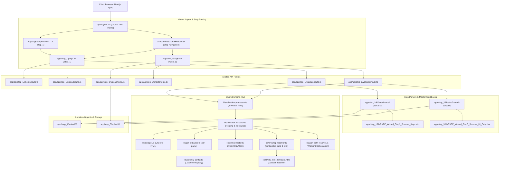
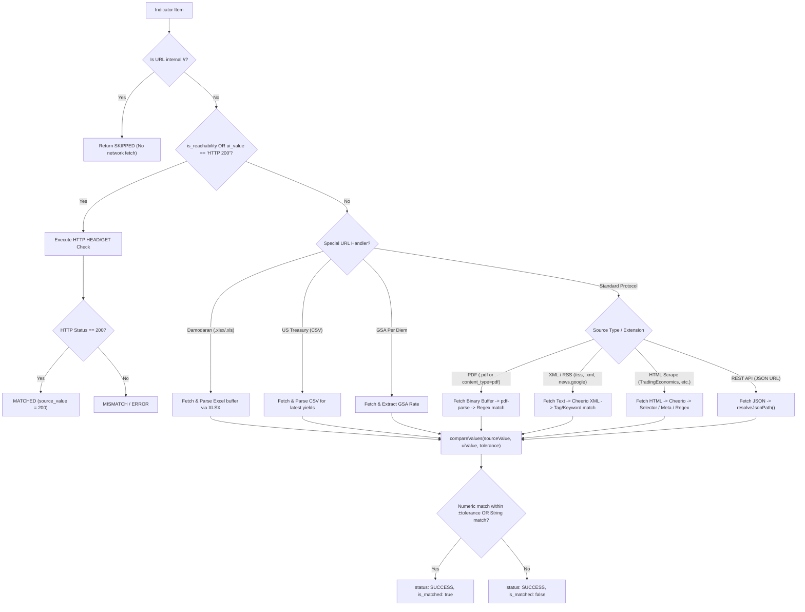

# RXBE Validation Engine: Execution & Implementation Structure Guide

An architectural and technical guide detailing the end-to-end execution, component hierarchy, isolated routing, parsing pipelines, and multi-protocol live audit engine for the **RXBE Validation Engine**.

---

## 1. High-Level Architecture Overview

The system is built on **Next.js (App Router)** and **Bun**, implementing an isolated multi-step auditing architecture. Each step operates independently with dedicated routes, APIs, parsers, and upload directories while sharing a common layout, design system, and multi-protocol extraction engine.

### System Architecture Diagram



---

## 2. Directory & File Structure

The project strictly follows the modular structure specified for Step 1 and Step 3 isolation:

```
val/
├── app/
│   ├── api/
│   │   ├── step_1/
│   │   │   ├── sheets/route.ts        # Discovers Step 1 workbooks & sheets
│   │   │   ├── upload/route.ts        # Uploads/deletes Step 1 workbooks
│   │   │   └── validate/route.ts      # Validates Step 1 indicators or custom JSON
│   │   └── step_3/
│   │       ├── sheets/route.ts        # Discovers Step 3 workbooks & sheets
│   │       ├── upload/route.ts        # Uploads/deletes Step 3 workbooks
│   │       └── validate/route.ts      # Validates Step 3 indicators (including reachability)
│   ├── step_1/
│   │   ├── _components/
│   │   │   ├── Step1ResultsView.tsx   # Results metrics bar, filters & results table
│   │   │   ├── Step1UploadModal.tsx   # Modal with country & state selectors
│   │   │   └── Step1WorkbookTable.tsx # 6-column workbooks & sheets table
│   │   ├── lib/
│   │   │   ├── RXBE_Wizard_Step1_Sources_Keys.xlsx # Master baseline Excel
│   │   │   └── step1-excel-parser.ts  # Parser for 34 Step 1 indicators
│   │   ├── upload/                    # Saved uploaded workbooks by country/state
│   │   └── page.tsx                   # Dedicated Step 1 UI route (/step_1)
│   ├── step_3/
│   │   ├── _components/
│   │   │   ├── Step3ResultsView.tsx   # Step 3 section results & reachability display
│   │   │   ├── Step3UploadModal.tsx   # Step 3 location upload modal
│   │   │   └── Step3WorkbookTable.tsx # Step 3 workbooks & sheets table
│   │   ├── lib/
│   │   │   ├── RXBE_Wizard_Step3_Sources_UI_Only.xlsx # Master baseline Excel
│   │   │   └── step3-excel-parser.ts  # Parser for 43 Step 3 indicators
│   │   ├── upload/                    # Saved uploaded workbooks by country/state
│   │   └── page.tsx                   # Dedicated Step 3 UI route (/step_3)
│   ├── layout.tsx                     # Root global layout with GlobalHeader
│   ├── page.tsx                       # Redirects root / to /step_1
│   └── globals.css                    # Tailwind CSS tokens
├── components/
│   ├── GlobalHeader.tsx               # Minimalist header with Step 1 and Step 3 tabs
│   ├── Modal.tsx                      # Reusable accessible dialog backdrop & box
│   └── StatusBadge.tsx                # Status indicator pills (MATCHED, ERROR, etc.)
├── lib/
│   ├── RXBE_live_Template.html        # Embedded template baseline (LIVE_SNAP & data)
│   ├── country-config.ts              # Country registry (PG, FJ, VU, TON, WS, SLB, etc.)
│   ├── excel-utils.ts                 # Sheet inspection & directory scanning helpers
│   ├── indicator-validator.ts         # Multi-protocol live auditor & tolerance checker
│   ├── json-path-resolver.ts          # Dot-notation & wildcard JSON path resolution
│   ├── livesnap-resolver.ts           # Parser & cache for LIVE_SNAP from HTML template
│   ├── pdf-extractor.ts               # In-memory PDF text parser & regex search
│   ├── scrape-config-generator.ts     # HTML scraper selector & regex generator
│   ├── scraper.ts                     # Cheerio HTTP scraper with table/meta extractors
│   ├── types.ts                       # Core TypeScript interfaces & contracts
│   ├── validation-processor.ts        # 4-worker concurrency queue & summary accumulator
│   └── xml-extractor.ts               # RSS/Atom/XML feed parser
├── EXECUTION_AND_IMPLEMENTATION_GUIDE.md # This guide
├── package.json
├── tsconfig.json
└── next.config.ts                     # Next.js config with redirects
```

---

## 3. Core Engine: Protocol Execution & Validation

Validation is handled by [lib/indicator-validator.ts](file:///home/danish/project/val/lib/indicator-validator.ts) wrapped in a controlled 4-worker pool in [lib/validation-processor.ts](file:///home/danish/project/val/lib/validation-processor.ts).

### Validation Routing & Protocol Flow



### Tolerance Matching Engine

The comparison function (`compareValues` in [lib/indicator-validator.ts](file:///home/danish/project/val/lib/indicator-validator.ts)) uses a **dual-mode evaluation**:

1. **Composite UI Candidate Parsing**:
   - Complex UI strings (e.g., `"1,982.09 kWh/m2/yr, shown as 5.43 kWh/m2/day"`) are scanned with regex `-?\d+(?:\.\d+)?` to extract all candidate numbers (`[1982.09, 5.43]`).
   - If the source returns annual or daily figures, it matches against any valid candidate.

2. **Absolute & Relative Tolerance**:
   $$\text{Absolute Match} \iff |V_{\text{source}} - V_{\text{ui}}| \le \text{tolerance}$$
   $$\text{Relative Match} \iff \left|\frac{V_{\text{source}} - V_{\text{ui}}}{V_{\text{ui}}}\right| \le \text{tolerance}$$

3. **String Fallback Matching**:
   - Non-numeric responses (e.g., status text, badges) are normalized (`trim().toLowerCase()`) and evaluated for exact match or substring containment.

---

## 4. Step 1: Country, Province & Primary Sources

### Purpose & Scope
Validates baseline parameters for project metadata, location coordinates, macroeconomic indicators (repo rate, inflation, GDP), corporate tax profiles, regulatory access badges, and local energy tariffs.

### Key Components & Endpoints
- **Route**: [`/step_1`](file:///home/danish/project/val/app/step_1/page.tsx)
- **APIs**:
  - `GET /api/step_1/sheets`: Scans [app/step_1/lib/RXBE_Wizard_Step1_Sources_Keys.xlsx](file:///home/danish/project/val/app/step_1/lib/RXBE_Wizard_Step1_Sources_Keys.xlsx) and [app/step_1/upload/](file:///home/danish/project/val/app/step_1/upload/).
  - `POST /api/step_1/upload`: Validates file type, parses country & state, and stores file under `app/step_1/upload/<country>/<state>/<filename>`.
  - `DELETE /api/step_1/upload?filePath=...`: Removes an uploaded workbook.
  - `POST /api/step_1/validate`: Extracts 34 indicators via [app/step_1/lib/step1-excel-parser.ts](file:///home/danish/project/val/app/step_1/lib/step1-excel-parser.ts) and runs live validation.
- **UI Components**:
  - [Step1WorkbookTable.tsx](file:///home/danish/project/val/app/step_1/_components/Step1WorkbookTable.tsx): 6-column table (`Country & State`, `Workbook File`, `Sheet Name`, `Rows / Cols`, `Status`, `Action`).
  - [Step1UploadModal.tsx](file:///home/danish/project/val/app/step_1/_components/Step1UploadModal.tsx): Country dropdown, province dropdown, drag-and-drop dropzone, and destination path preview.
  - [Step1ResultsView.tsx](file:///home/danish/project/val/app/step_1/_components/Step1ResultsView.tsx): 5-column metric summary, source filter pills (`All`, `Scrape`, `Feeds`, `PDF`, `APIs`), search bar, and results audit table.

### Step 1 Indicator Breakdown (34 Indicators)
| Category | Indicator ID | Source Type | Extraction Target |
|:---|:---|:---|:---|
| Country Indicators | `central_bank_repo_rate` | Scrape | TradingEconomics interest-rate table cell |
| Country Indicators | `inflation_rate` | Scrape | TradingEconomics inflation table cell |
| Country Indicators | `gdp_annual_growth` | Scrape | TradingEconomics GDP growth rate |
| Tax & Duties | `corporate_tax_rate` | Scrape / Config | Country tax profile or statutory rate |
| Tax & Duties | `withholding_tax_dividends` | Scrape / Config | Statutory dividend withholding rate |
| Primary Energy | `solar_ghi_annual` | LiveSnap / API | Global Horizontal Irradiance ($kWh/m^2/yr$) |
| Primary Energy | `wind_speed_annual` | LiveSnap / API | Average surface wind speed ($m/s$) |
| Tariff Feeds | `retail_electricity_tariff` | Scrape / PDF | Regulatory gazette or power utility tariff |
| News & Regulatory | `xml_news_feed` | XML / RSS | Google News / Local gazette feed items |
| Internal Metadata | `project_grid_type` | Internal | Static project baseline |

---

## 5. Step 3: Resource & Risk Index

### Purpose & Scope
Audits the resource risk metrics, sovereign debt spreads, country risk premiums, cost of debt indices, capital structure multipliers, US Treasury benchmark yields, and regulatory website reachability.

### Key Components & Endpoints
- **Route**: [`/step_3`](file:///home/danish/project/val/app/step_3/page.tsx)
- **APIs**:
  - `GET /api/step_3/sheets`: Discovers [app/step_3/lib/RXBE_Wizard_Step3_Sources_UI_Only.xlsx](file:///home/danish/project/val/app/step_3/lib/RXBE_Wizard_Step3_Sources_UI_Only.xlsx) and [app/step_3/upload/](file:///home/danish/project/val/app/step_3/upload/).
  - `POST /api/step_3/upload`: Stores Step 3 workbooks under `app/step_3/upload/<country>/<state>/<filename>`.
  - `POST /api/step_3/validate`: Parses all 43 indicators via [app/step_3/lib/step3-excel-parser.ts](file:///home/danish/project/val/app/step_3/lib/step3-excel-parser.ts) and executes live validation.
- **UI Components**:
  - [Step3WorkbookTable.tsx](file:///home/danish/project/val/app/step_3/_components/Step3WorkbookTable.tsx): Filterable table for Step 3 workbooks.
  - [Step3UploadModal.tsx](file:///home/danish/project/val/app/step_3/_components/Step3UploadModal.tsx): Location-based upload dialog.
  - [Step3ResultsView.tsx](file:///home/danish/project/val/app/step_3/_components/Step3ResultsView.tsx): Displays screen sections, platform keys, "Where it shows", difference tolerance, and reachability badges.

### Step 3 Indicator Decisions & Structure (43 Indicators)
1. **Duplicate Row Preservation**: Rows 3 and 17 (Project Coordinates) and rows 7 and 24 (Solar GHI) are validated separately without deduplication.
2. **URL Reachability Checks**: Rows 35–40 (which have URLs but empty platform indicator keys) are validated via HTTP HEAD/GET requests expecting `HTTP 200`.

### Step 3 Indicator Section Map
| Screen Section | Count | Key Indicators / Sources |
|:---|:---:|:---|
| `General Project Data` | 6 | Coordinates (Lat/Lon), Distance to Grid, Land Area, Location Notes |
| `Country Specific Multipliers` | 8 | Country Risk Premium, Corporate Tax, Default Spread, Subsidies |
| `Regulatory, Access & Tenure Badges` | 10 | Grid access authorization, tenure rights, environmental clearance |
| `Country Risk Index` | 7 | Damodaran rating, sovereign CDS spread, Moody's/S&P equivalent |
| `Cost of Debt & Benchmark Yields` | 6 | US Treasury 10Y/20Y/30Y yield curve CSV feeds |
| `Regulatory Authority Feeds` | 6 | Live URL Reachability checks for local gazettes & commissions |

---

## 6. Shared Engine (`lib/`) Component Reference

| File | Primary Functions | Key Responsibilities |
|:---|:---|:---|
| [lib/types.ts](file:///home/danish/project/val/lib/types.ts) | Types & Interfaces | Defines `Indicator`, `IndicatorResult`, `ValidationResponse`, `ScrapeConfig`, `XmlConfig`, `WorkbookInfo`. |
| [lib/country-config.ts](file:///home/danish/project/val/lib/country-config.ts) | `getCountryConfig()`, `getAvailableCountryOptions()` | Country registry for Papua New Guinea, Fiji, Vanuatu, Tonga, Samoa, Solomon Islands, etc. |
| [lib/validation-processor.ts](file:///home/danish/project/val/lib/validation-processor.ts) | `processValidation()` | Manages 4-worker concurrency pool, batches tasks, and builds `ValidationSummary`. |
| [lib/indicator-validator.ts](file:///home/danish/project/val/lib/indicator-validator.ts) | `validateIndicator()`, `compareValues()` | Dual-mode tolerance comparison, protocol branching, reachability checks, Damodaran/Treasury parsers. |
| [lib/scraper.ts](file:///home/danish/project/val/lib/scraper.ts) | `scrapeValue()` | HTTP requests, HTML parsing with Cheerio, table cell lookup, regex extraction. |
| [lib/pdf-extractor.ts](file:///home/danish/project/val/lib/pdf-extractor.ts) | `extractPdfText()`, `scrapePdfValue()` | Buffer-level PDF download, `pdf-parse` extraction, tabular and numeric regex parsing. |
| [lib/xml-extractor.ts](file:///home/danish/project/val/lib/xml-extractor.ts) | `extractXmlValue()`, `isXmlContent()` | RSS, Atom, and XML parsing for news feeds and regulatory notices. |
| [lib/livesnap-resolver.ts](file:///home/danish/project/val/lib/livesnap-resolver.ts) | `loadLiveSnap()`, `getProvinceResource()` | In-memory cache of embedded `#data` and `LIVE_SNAP` from `lib/RXBE_live_Template.html`. |
| [lib/json-path-resolver.ts](file:///home/danish/project/val/lib/json-path-resolver.ts) | `resolveJsonPath()` | Resolves dot-notation (`data.rates[0].value`) and array indexing from JSON responses. |
| [lib/excel-utils.ts](file:///home/danish/project/val/lib/excel-utils.ts) | `inspectWorkbookSheets()`, `findExcelFiles()` | Fast sheet metadata inspection (row counts, column headers) and recursive directory discovery. |

---

## 7. Step-by-Step Runtime Execution Flows

### Flow 1: Initial Application Load
1. User navigates to `http://localhost:3000/`.
2. Next.js router in [app/page.tsx](file:///home/danish/project/val/app/page.tsx) automatically redirects to `/step_1`.
3. [app/layout.tsx](file:///home/danish/project/val/app/layout.tsx) mounts the global layout, rendering [components/GlobalHeader.tsx](file:///home/danish/project/val/components/GlobalHeader.tsx).
4. [app/step_1/page.tsx](file:///home/danish/project/val/app/step_1/page.tsx) executes a client-side `useEffect` calling `GET /api/step_1/sheets`.
5. The API scans [app/step_1/lib/](file:///home/danish/project/val/app/step_1/lib/) for the default baseline workbook and [app/step_1/upload/](file:///home/danish/project/val/app/step_1/upload/) for uploaded sheets.
6. [Step1WorkbookTable.tsx](file:///home/danish/project/val/app/step_1/_components/Step1WorkbookTable.tsx) populates the discovered workbooks in a "Ready" status without triggering automatic validation.

### Flow 2: Uploading an Excel Sheet
1. User clicks **Upload Excel** in the table toolbar.
2. [Step1UploadModal.tsx](file:///home/danish/project/val/app/step_1/_components/Step1UploadModal.tsx) opens.
3. User selects a Country (or chooses Custom Country) and a State/Province.
4. The live path preview displays:
   `app/step_1/upload/<Country>/<State>/<filename>.xlsx`
5. User drops or selects an Excel file (`.xlsx` or `.xls`) and clicks **Upload & Save Sheet**.
6. The modal sends a `multipart/form-data` POST request to `POST /api/step_1/upload`.
7. The API validates the file format, creates the target directory recursively, writes the buffer to disk, and returns HTTP 201.
8. The workbook table reloads and displays the new sheet under an "Uploaded" badge with its specific country and state.

### Flow 3: Live Sheet Validation
1. User clicks **Validate Sheet** on any sheet row.
2. The row status changes to **Validating...** with a pulsing indicator and a loading spinner.
3. The page sends a POST request to `/api/step_1/validate` (or `/api/step_3/validate`):
   ```json
   {
     "filePath": "app/step_1/lib/RXBE_Wizard_Step1_Sources_Keys.xlsx",
     "sheetName": "Papua_New_Guinea",
     "country": "Papua New Guinea",
     "countryCode": "PG",
     "province": "National Capital District"
   }
   ```
4. The API verifies the file path is within allowed directories (`app/step_1/upload` or `app/step_1/lib`).
5. The step parser extracts the indicators array.
6. [lib/validation-processor.ts](file:///home/danish/project/val/lib/validation-processor.ts) spawns a 4-worker pool that evaluates indicators concurrently with 25-second timeouts.
7. Results are assembled into a `ValidationResponse` object with summary metrics.
8. The frontend receives the response, renders the minimal metrics bar (`Indicators`, `Matched`, `Mismatches`, `Errors`, `Overall Status`), and displays the indicator results table.

### Flow 4: Custom JSON Payload Testing
1. User clicks **Custom JSON** in the page header.
2. A drawer opens with a pre-filled JSON structure containing sample indicators.
3. User edits indicator IDs, URLs, JSON paths, UI target values, or tolerances, then clicks **Execute Test**.
4. The payload is sent directly to `POST /api/step_1/validate`.
5. The live auditor processes the custom array and renders the audit results in the table below.

---

## 8. Theme & Styling Guidelines

The application strictly preserves the original **Tailwind `zinc` dark theme**:

| Element | Tailwind Classes |
|:---|:---|
| **Page Container** | `min-h-screen bg-zinc-950 text-zinc-100 font-sans antialiased` |
| **Content Wrapper**| `max-w-6xl mx-auto px-4 sm:px-6 py-6 sm:py-10 space-y-6` |
| **Section Cards**  | `rounded-xl border border-zinc-800/80 bg-zinc-900/40 p-4 sm:p-5 space-y-4` |
| **Table Wrappers** | `rounded-lg border border-zinc-800/80 bg-zinc-950/50 overflow-hidden` |
| **Table Headers**  | `bg-zinc-900/80 text-zinc-400 font-medium border-b border-zinc-800/80` |
| **Primary Buttons**| `px-3.5 py-1.5 rounded-lg text-xs font-medium bg-zinc-100 hover:bg-white text-zinc-900` |
| **Secondary Buttons**| `px-3 py-1.5 rounded-lg text-xs font-medium text-zinc-400 hover:text-zinc-200 hover:bg-zinc-900 border border-zinc-800` |
| **Active Tabs**    | `bg-zinc-800 text-zinc-100 shadow-sm border border-zinc-700/80 rounded-md` |
| **Modal Backdrops**| `fixed inset-0 bg-black/70 backdrop-blur-sm` |
| **Modal Container**| `w-full max-w-lg rounded-2xl bg-zinc-900 border border-zinc-800 shadow-2xl p-6` |
